# TXG Group Finance Intelligence: the spec explained in simple English

> **Source:** `TXG-Group-Finance-Intelligence-Build-Spec-v1.2.docx` (20 Nov 2026, 1,650 lines of text, 6 figures).
> **Client's question:** *"Go through this document and let me know if we can implement this properly."*
> **This file:** what the document says, in plain words, with examples and diagrams, followed by my honest answer to the client's question (Part 9).
>
> **How to view the diagrams:** the flow charts are written in Mermaid. They show up automatically in VS Code (Markdown Preview Mermaid Support extension), GitHub and most Markdown viewers. The original figures from the document are in the `images/` folder next to this file.

---

## Contents

1. [The 60-second version](#1-the-60-second-version)
2. [What does TXG actually want?](#2-what-does-txg-actually-want)
3. [What are we building? (4 deliverables)](#3-what-are-we-building-4-deliverables)
4. [The one rule everything follows](#4-the-one-rule-everything-follows)
5. [How the system works, step by step](#5-how-the-system-works-step-by-step)
6. [The dashboard: what the CEO/CFO sees](#6-the-dashboard-what-the-ceocfo-sees)
7. [The clever statistics, in plain English](#7-the-clever-statistics-in-plain-english)
8. [The acquisition workspace](#8-the-acquisition-workspace)
9. [Can we implement this properly? My assessment](#9-can-we-implement-this-properly-my-assessment)
10. [What is already built (the example folder)](#10-what-is-already-built-the-example-folder)
11. [Mini glossary](#11-mini-glossary)

---

## 1. The 60-second version

**TXG Group** is a Saudi holding company that owns about **25 companies** (contracting, food, retail, healthcare, logistics, hotels...). Each company keeps its accounts in **Zoho Books** (accounting software), and some in other software.

The CEO and CFO today cannot easily answer simple questions like *"Which of my companies is in trouble? Will we have the cash? Who is paying us late?"* because the information is spread across 25 separate systems.

**The spec describes a product that:**

1. **Connects** to all 25 accounting systems (read-only).
2. **Cleans and standardises** all the books so they can be compared.
3. **Calculates ~40 health numbers (KPIs)** for each company, plus industry-specific ones.
4. **Uses statistics to avoid false alarms** and only shows what really matters, ranked by money at stake.
5. **Updates within seconds** when someone changes an invoice.
6. **Has a second tool for buying companies**: finds targets, values them, and says "Buy / Buy at or below SAR X / Walk away".

**Important:** for the *proposal* we are **not** building the live product for TXG. We build a **demo version on made-up data** (a fake group called "Example Holding") to show TXG what it would look like.

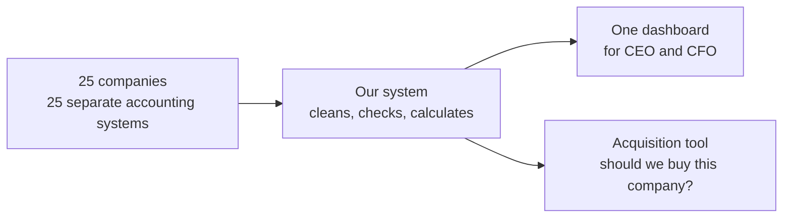

---

## 2. What does TXG actually want?

The CEO and CFO asked for a finance module where they **pick any company from a drop-down** and see:

| # | Question they want answered | Plain meaning |
|---|---|---|
| 1 | Is each company really performing? | Is it actually making money? |
| 2 | What is going well or badly? Which ratio is falling? | Early warnings |
| 3 | What must be paid, and when? | Upcoming bills, salaries, tax |
| 4 | What is pending? | Orders not yet invoiced, open items |
| 5 | Will we have the cash? | Cash forecast for next 13 weeks |
| 6 | Are customers paying us on time? | Receivables health |
| 7 | Which business driver is at risk? | e.g. rising supplier prices |
| 8 | Is a company getting fragile? | Debt, loan conditions |
| 9 | Whose numbers can we trust? | Data quality |
| 10 | What looks suspicious? | Possible fraud/errors (CFO only) |
| 11 | Is the group diversified, what is it worth? | Group-level view |
| 12 | Is this acquisition worth it, at what price? | Deal tool |

### Saudi-specific things the system must handle

| Topic | What it is | Why it matters |
|---|---|---|
| **VAT** | 15% tax, filed monthly or quarterly | Appears in the "what must be paid" calendar |
| **Zakat** | Islamic annual levy, due within 120 days of year-end | A big, predictable cash outflow |
| **GOSI** | Monthly social-insurance payment | Payroll cash planning |
| **End-of-service benefits** | Money owed to employees when they leave | A hidden "debt" when buying a company |
| **Ramadan / Eid** | Move ~11 days earlier every year | Sales dip in March 2025 but in Feb 2026, so year-on-year comparisons lie unless adjusted |
| **Work week** | Sunday to Thursday | Weekly cash view starts on Sunday |
| **Government customers** | Big share of revenue, pay slowly and unpredictably | Main cash risk |

---

## 3. What are we building? (4 deliverables)

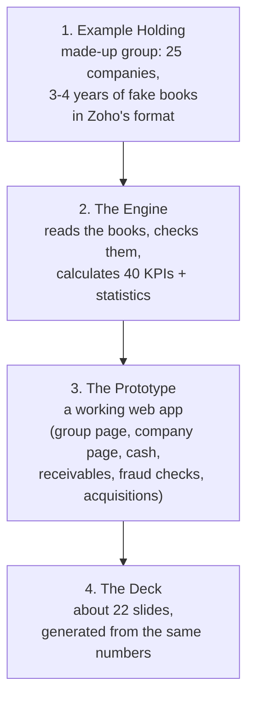

| Deliverable | In one sentence | "Done" means |
|---|---|---|
| **1. Example Holding** | Fake-but-realistic company group so we can demo without TXG's real data | Every trial balance adds up; every planted problem is found; quiet companies stay quiet |
| **2. The Engine** | The brain: connector, cleaning, KPI maths, statistics, explanations, valuation | Every number can be traced back to its source; results can be replayed identically |
| **3. The Prototype** | The web app the CEO/CFO would use | Every screen is drawn from engine results, nothing typed by hand, every click works |
| **4. The Deck** | Presentation for TXG | Every number on every slide is checked by a script against engine output |

**Not in scope:** a video, real TXG data (they have given none), production hosting, an Arabic interface (English only, but must be possible later), valuing real listed companies.

---

## 4. The one rule everything follows

> **"Code counts, the model reads, people decide, the record remembers."**

("The model" = an AI language model like GPT/Claude.)

| Who | Does what | Example |
|---|---|---|
| **Code** (normal programs) | Everything that is the same for every company: fetching data, arithmetic, statistics, checks | Adding up invoices, calculating DSO |
| **The model** (AI) | Things that need *reading and judgement* | Reading an Arabic account name like "ذمم مدينة" and deciding it means "Trade receivables"; reading a loan agreement PDF |
| **People** | Decide what to *do* about the results | CFO chases the late-paying client |
| **The record** | Remembers every step, forever | Can replay any month and get the identical answer |

### Two golden safety rules

1. **The AI never produces a number.** It can name things and copy numbers printed in documents, but code does all calculations. If the AI types a number in an explanation, the sentence is **refused**.
2. **Every AI output is checked by code before it is used.**

### The surprising rule: no approval steps

Normally a human approves things like "this account maps to *Revenue*". **This spec says no.** Instead:

- AI proposes, code checks, it is **applied automatically**.
- Important decisions are read **twice by two independent AIs** (the second never sees the first's answer).
- If they disagree, the higher-confidence one is used, but the affected numbers get an **"unreviewed" marker**.
- Humans can **review and override later**, and history is recalculated.
- **Data problems** (books that do not balance) automatically **hold** that company-month until fixed.

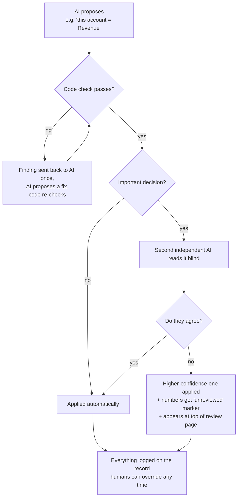

---

## 5. How the system works, step by step

### 5.1 The big picture (the spec's Figure 1)

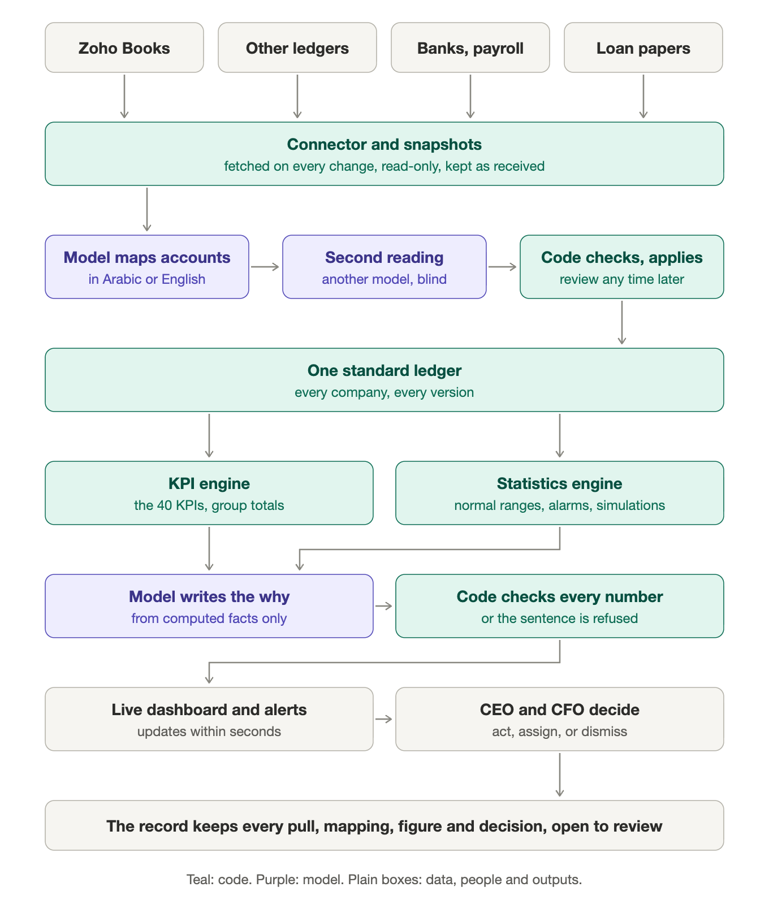

*Teal = code, purple = AI, plain = data/people/outputs.*

The same thing as a simple flow:

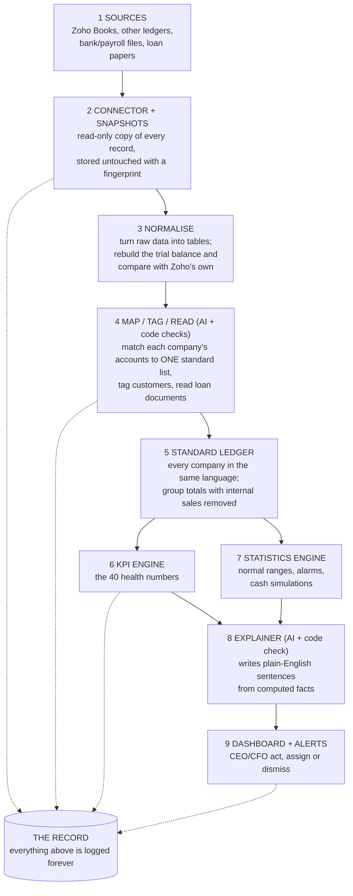

### 5.2 Why "standardising" the books is the hard core of this product

Every company names its accounts differently.

| Company | Their account name | Standard account (our list) |
|---|---|---|
| Contracting A | `ذمم مدينة - عملاء حكوميين` | **Trade receivables** |
| Food Dist. A | `Debtors` | **Trade receivables** |
| Retail A | `Customer balances / أرصدة العملاء` | **Trade receivables** |

The AI decides which of a company's accounts belongs to which standard account. Without this, "DSO" for company A and B would not mean the same thing and you could not compare them.

The spec gives a worked example: the AI receives the account, plus its monthly balances and sample transaction descriptions, and answers with a **mapping proposal** including its evidence and confidence:

```json
{ "account_id": "460000001234", "std_code": "1120",   // Trade receivables
  "confidence": "high",
  "evidence": ["name: Trade receivables - government",
               "zoho_type: accounts_receivable",
               "counterpart: income 82%"] }
```

### 5.3 The "trial balance" gate (the most important safety check)

A **trial balance** is a list of every account with its balance. In correct books, total debits = total credits. Zoho also prints its own trial balance.

**Rule:** the system rebuilds the trial balance from raw transactions and compares it with Zoho's printed one **to the riyal (SAR 0.00 per account)**. If it does not match, **that company-month is automatically "held"**.

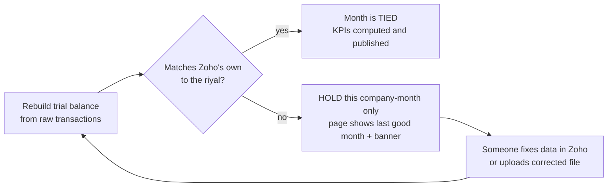

**Example (planted story S12, Manpower Services):** one account is off by a late adjustment. The page shows *"Held: showing September"* with a banner. When the corrected file ties, the hold **releases itself**. No approval.

### 5.4 Real time: "a change shows up within seconds"

A big feature of v1.2. Instead of a nightly batch, only what a change affects is recalculated.

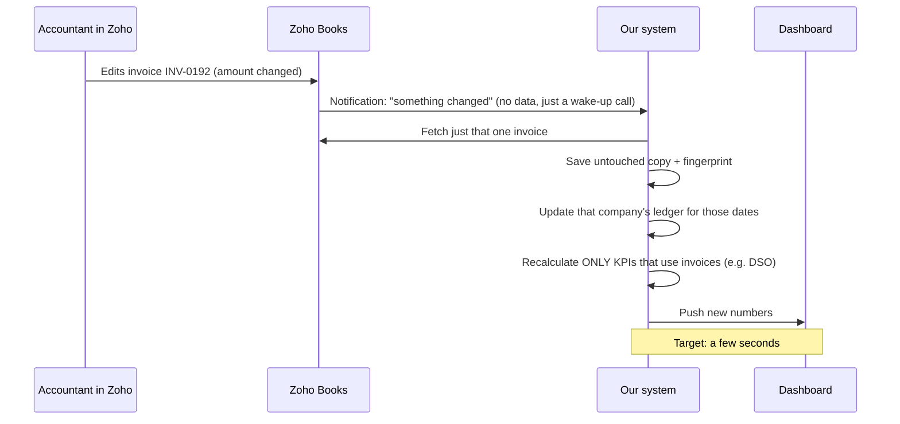

- Zoho webhook payloads contain contact details, so the system **uses them only as a wake-up signal**, verifies the signature, throws the payload away, then fetches the record itself.
- **Safety net:** every few minutes it also asks Zoho "what changed since last time?", in case a notification was missed.
- **Provisional numbers:** things that depend on month-end entries (depreciation, accruals, Zakat) are marked **provisional** (dotted outline) until the books close. A half-finished month is never compared with a full month.

### 5.5 What data is needed (5 "tiers")

The more data a company gives, the more the system can show.

| Tier | Data | What it unlocks |
|---|---|---|
| 1 | Monthly trial balance only | Statements, most ratios, group totals |
| 2 | + invoices, bills, payments, contacts | 13-week cash, receivables, concentration |
| 3 | + manual journals with timestamps/users | Fraud-style integrity tests |
| 4 | + budgets, orders, operating data | Budget KPIs, drivers, sector modules |
| 5 | + loan papers, approval limits, contracts | Loan-covenant headroom, maturities |

**Non-Zoho companies** connect through an "adapter" that must produce the same tables. Minimum: a monthly trial balance (tier 1).

### 5.6 Explanations the AI writes (with the number check)

The AI gets **facts**, not raw data, and writes a sentence that can only refer to numbers by fact ID:

```
FACT f1: cash conversion = 38%   (normal range 71-86%, status Act, slipping)
FACT f2: days late, two government clients = 38 days, SAR 23m at stake

AI output: "Profitable, but cash is tightening: two government clients
            are paying {f2} later than their normal ..."
```

Code swaps the `{f2}` for the real value. If the AI writes a free-typed number like "38 days" itself, the sentence is **refused**, retried once, and if it fails again the card shows numbers only.

---

## 6. The dashboard: what the CEO/CFO sees

### 6.1 The company page (the spec's Figures 4 and 5)

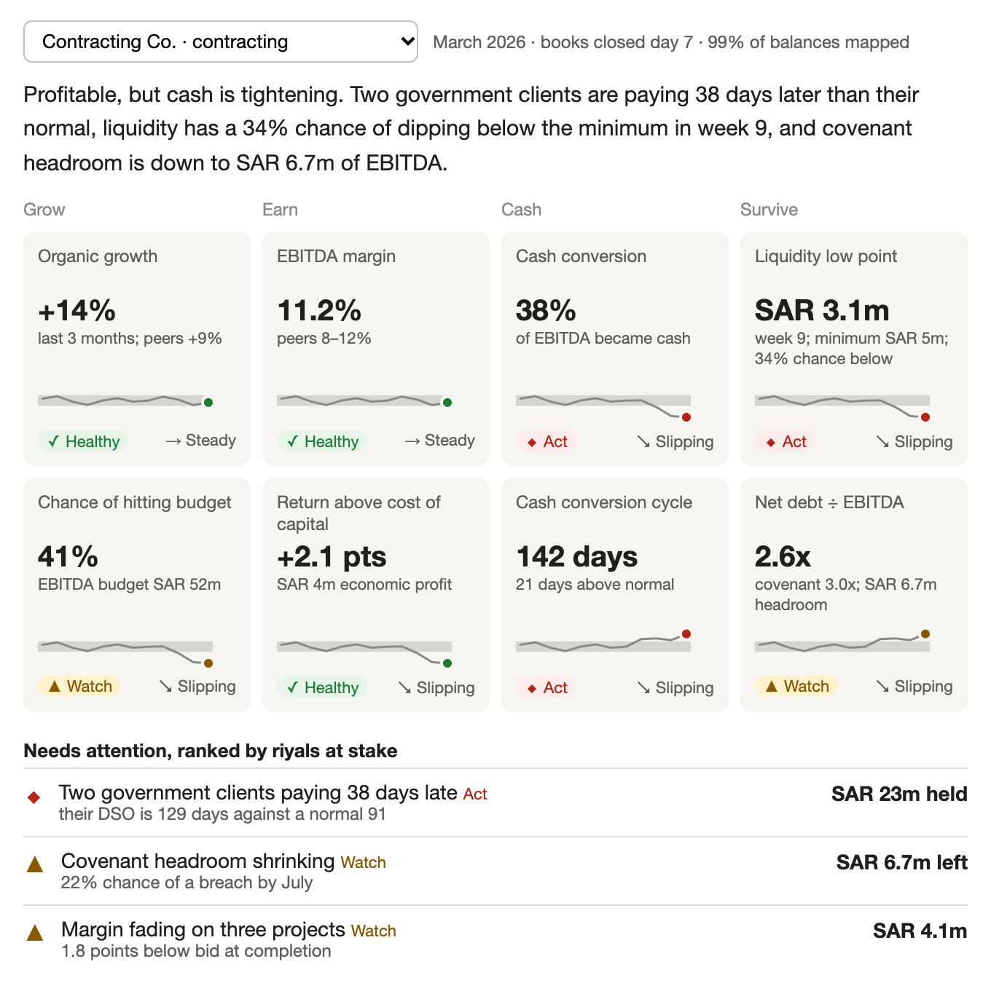

Read it from top to bottom:

| Area | What it shows | Example from the figure |
|---|---|---|
| **Company selector** | Drop-down grouped by sector, plus "Whole group" | "Contracting Co." |
| **Trust badge** | Are the numbers trustworthy? | "books closed day 7, 99% of balances mapped" |
| **Verdict line** | 1-2 sentence summary written by AI from facts | "Profitable, but cash is tightening..." |
| **8 headline tiles in 4 pairs** | The most important KPIs | Grow / Earn / Cash / Survive |
| **Attention list** | What needs action, ranked by **riyals at stake** | "Two government clients paying 38 days late: SAR 23m held" |

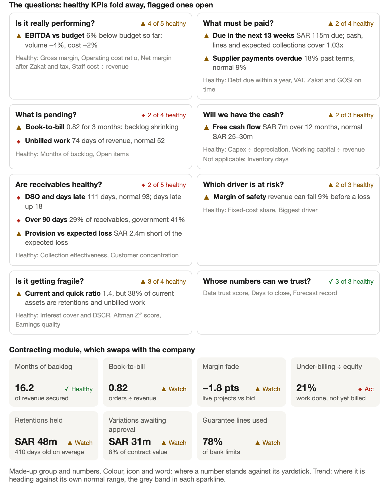

Below that, 8 **question panels** (healthy KPIs are folded into one line; flagged ones open up) and a **sector module** that changes per company (e.g. contracting shows "backlog", healthcare shows "claim rejection rate").

### 6.2 The 8 headline KPIs

| Pair | KPI | In plain English |
|---|---|---|
| **Grow** | Organic growth | Sales growth vs last year, with Ramadan effect removed and acquisitions excluded |
| | Chance of hitting budget | Out of 10,000 simulated years, in how many does EBITDA reach budget? |
| **Earn** | EBITDA margin | Operating profit as % of sales |
| | Return above cost of capital | Is the business earning more than its money costs? |
| **Cash** | Cash conversion | Of each riyal of EBITDA, how much became real cash? |
| | Cash conversion cycle | Days between paying suppliers and collecting from customers |
| **Survive** | Liquidity low point | Lowest cash balance expected in next 13 weeks |
| | Net debt ÷ EBITDA | Debt compared to earnings, vs the bank's loan limit |

Then **32 supporting KPIs** in 8 panels (Is it really performing? What must be paid? What is pending? Will we have cash? Are receivables healthy? Which driver is at risk? Is it fragile? Whose numbers can we trust?). That makes **40 common KPIs**, plus **sector KPIs**: contracting, trading, retail, healthcare, manufacturing, logistics, real estate, hospitality, facility management, IT services (about 70 more).

### 6.3 Two signals on every KPI (the spec's Figure 2)

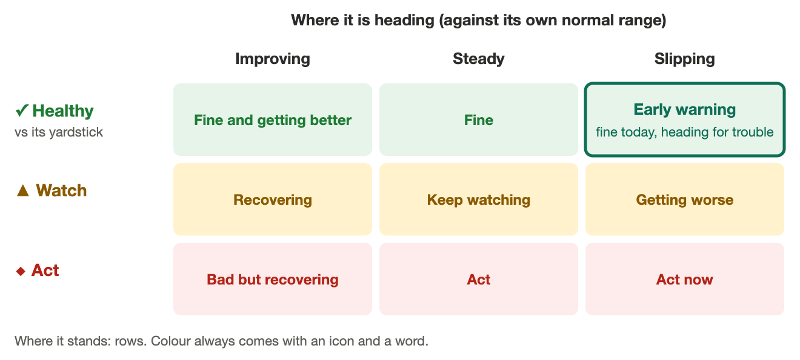

Every number answers **two separate questions**:

| | **Where it stands** (today vs a yardstick) | **Where it is heading** (vs its own normal) |
|---|---|---|
| Icon/word | ✓ Healthy, ▲ Watch, ◆ Act | ↗ Improving, → Steady, ↘ Slipping |

**The important combination: Healthy + Slipping = "early warning".** Today fine, but trending the wrong way. A normal dashboard would show a green light until it is too late.

Colour is never alone: always colour + icon + word (accessibility).

Other states: *Context* (grey, neither good nor bad), *Not applicable*, *Needs data*, *Provisional*, *Held*, *Unreviewed*, *Borrowed range*.

### 6.4 The yardstick: what "good" means

Instead of one red/amber/green rule for everything, each KPI states **which yardstick** it uses:

| Yardstick | Meaning | Example |
|---|---|---|
| Hard limit | A line that must not be crossed | Loan covenant, minimum cash |
| Hurdle | A line that defines success | Return above cost of capital > 0; book-to-bill > 1.0 |
| Peer band | Compare to similar companies | "Worse than 9 in 10 peers" = Act |
| Own normal | Compare to the company's own history | Operating cost ratio |
| None | Just information | Shown grey |

### 6.5 The group page and heat-grid

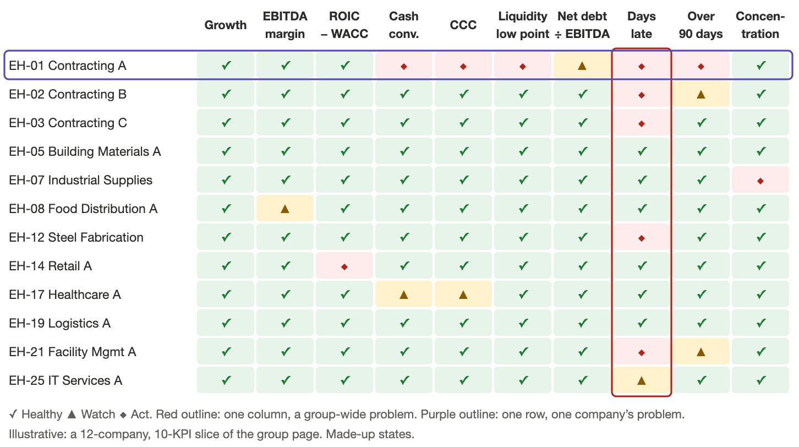

Companies down the side, KPIs across the top. **A red column = a group-wide problem** (e.g. all government customers paying late). **A red row = one company's problem.** A normal dashboard cannot tell these apart.

### 6.6 Other screens

| Screen | Purpose |
|---|---|
| KPI drawer | Click any number: formula, which accounts, which documents, down to the actual invoice ("every number has a receipt") |
| Cash & obligations | 13-week cash forecast as a fan chart; what-if toggles ("government pays 30 days later") |
| Receivables | Ageing, loss expectation, top customers |
| Integrity (CFO only) | Suspicious-pattern tests, shown as "worth a look", never an accusation |
| Review | List of everything the system decided by itself, with an override button |
| Sunday brief | 5-line weekly summary |
| Settings | Tolerances, minimum cash, roles |

### 6.7 Always-on red banners (hard checks, never hidden)

- A loan covenant is breached (or is likely to be)
- Cash is forecast to fall below the minimum
- A VAT/Zakat/GOSI payment is late
- Accumulated losses reach half of share capital (Companies Law)
- Equity is negative
- A loan matures within 90 days with no refinancing
- Trial balance does not tie

---

## 7. The clever statistics, in plain English

This section is why the spec says normal dashboards fail. Each trick comes with a small example.

### 7.1 Problem: too many false alarms

25 companies x 40 KPIs = **1,000 readings a month**. If each has a 5% chance of a false alarm, that is about **50 false alarms every month**. People stop reading alerts (the spec cites hospitals, where 85-99% of alarms need no action).

**Fix: the "false-alarm limit" (Benjamini-Hochberg, set to 10%).**

Example: 1,000 tests. The 5 smallest p-values (smaller = more surprising) are 0.00002, 0.0001, 0.0002, 0.004, 0.02. Each must beat a sliding threshold: 0.0001, 0.0002, 0.0003, 0.0004, 0.0005. Only the first **3** pass. A fixed 5% threshold would have kept all 5, plus ~50 noise alerts. The rejected ones go into a **"not alarmed" log** so you can see the discipline.

### 7.2 Problem: Ramadan moves

Ramadan filled nearly all of March 2025 but started around 18 Feb in 2026.

> A retailer's March sales are **11% lower than last March**. A normal dashboard screams. Ours says: *"Ramadan moved. After removing the holiday effect, March like-for-like is actually +3.9%. Not alarmed."*

The system *measures* the Ramadan effect from the company's own history (it does not assume it is positive: cafes may fall, retail may rise). Real result from the example data (Retail A): March 2026 vs March 2025 = **-10.9%** raw, **+3.9%** after removing the holiday.

### 7.3 Problem: the total lies

| | Revenue before | Revenue after | Margin before | Margin after |
|---|---|---|---|---|
| Company A | 100 | 200 | 8% | **9%** (up) |
| Company B | 100 | 100 | 30% | **31%** (up) |
| **Group** | 200 | 300 | **19.0%** | **16.3%** (down!) |

Both companies improved, yet the group margin fell, because the low-margin company grew faster (**mix**). The system splits every group change into **company performance (+1.00 pt)** and **mix (-3.67 pts)**; total -2.67 pts. Exactly.

### 7.4 Problem: profit is not cash

A company with SAR 120m revenue whose customers slow from paying in 90 days to 150 days ties up about **SAR 20m** (120 x 60 / 365). On a profit dashboard it is a star. In reality it is the risk of the month. So the product puts **cash first**: 13-week cash simulation, DSO, days late.

**DSO example (from the spec):** sales last 3 months SAR 9.2m, receivables SAR 6.0m (of which SAR 3.0m not yet due).
- DSO = 6.0 / 9.2 x 92 = **60 days**
- Best possible DSO (if everyone paid on time) = 3.0 / 9.2 x 92 = **30 days**
- **Days late = 30 days**

### 7.5 "Normal range" per KPI

Each KPI gets its own normal band from its own last 24 months (excluding the latest 3). A new reading outside the band, or 8 readings in a row on the same side of the average, is a signal. It is the classic factory quality-control chart applied to finance.

### 7.6 The 13-week cash simulation ("Monte Carlo")

Instead of one forecast, the system plays out **10,000 possible futures**:
- Each open invoice is collected on its due date plus a delay drawn from *that customer's own payment history*.
- Bills, payroll, GOSI, VAT, Zakat, loan repayments are scheduled.
- Each simulated path has a lowest-cash week. Report: the median low point, and **the chance of falling below the minimum**.

Real-looking output from the sample screen: *"34% chance of dipping below the minimum in week 9."* Better than a single line that says "cash will be 3.1m".

### 7.7 Chance of hitting budget

Forecast the remaining months, then add random errors sampled from the company's **own past forecast errors**, 10,000 times. "41% chance" = 41% of simulated years reached the budget.

### 7.8 Expected loss on receivables

Track every invoice month by month through age buckets (not due, 1-30, 31-60, ... written off). From history, compute the chance a riyal in each bucket ends up lost; sum it up = the IFRS 9 expected credit loss. Compare with the provision the company booked. Shortfall = KPI.

### 7.9 Honest uncertainty and calibration

Every forecast stores its range. Later, the system checks: *did 80% ranges really contain ~80% of actual outcomes?* If not, future ranges are automatically widened (logged, not silent).

**Budget bias check (example):** 7 of the last 8 budgets were too high. Chance of that by luck = 9/256 = 3.5%. So "this company's budgets are systematically optimistic".

### 7.10 Integrity tests (CFO only): "worth a look"

| Test | What it spots (simple) |
|---|---|
| Benford's law | Fake numbers have unnatural first digits |
| Bunching below approval limit | Many bills at SAR 49,500 when the limit is SAR 50,000 |
| Back-dating | Journals created 30+ days after their date, in closed months |
| Edited after close / despite lock | Changes to supposedly finished months |
| Unusual users/times | Rare posters, Friday postings |
| Round / repeated amounts | Too many 5,000.00s |
| Duplicate bills | Same supplier, ~same amount, close dates |
| New supplier paid fast | Created last week, paid today |
| Supplier without VAT no. | Large supplier with no VAT registration |
| Revenue cut-off | Big invoices on the last days of a quarter, credit notes just after |
| Intercompany mismatches | A says it is owed 4.2m, B says it owes 3.1m |
| Beneish M-score | Statistical earnings-manipulation score |

They are always phrased as **"worth a look"**, never "fraud". A second small AI reviews wording to make sure it never accuses.

---

## 8. The acquisition workspace

Purpose: **"Is this deal worth it, and at what price?"** It reuses the engines of the existing **Sharpe AI** product (peer screening, comps, DCF, deal pricing).

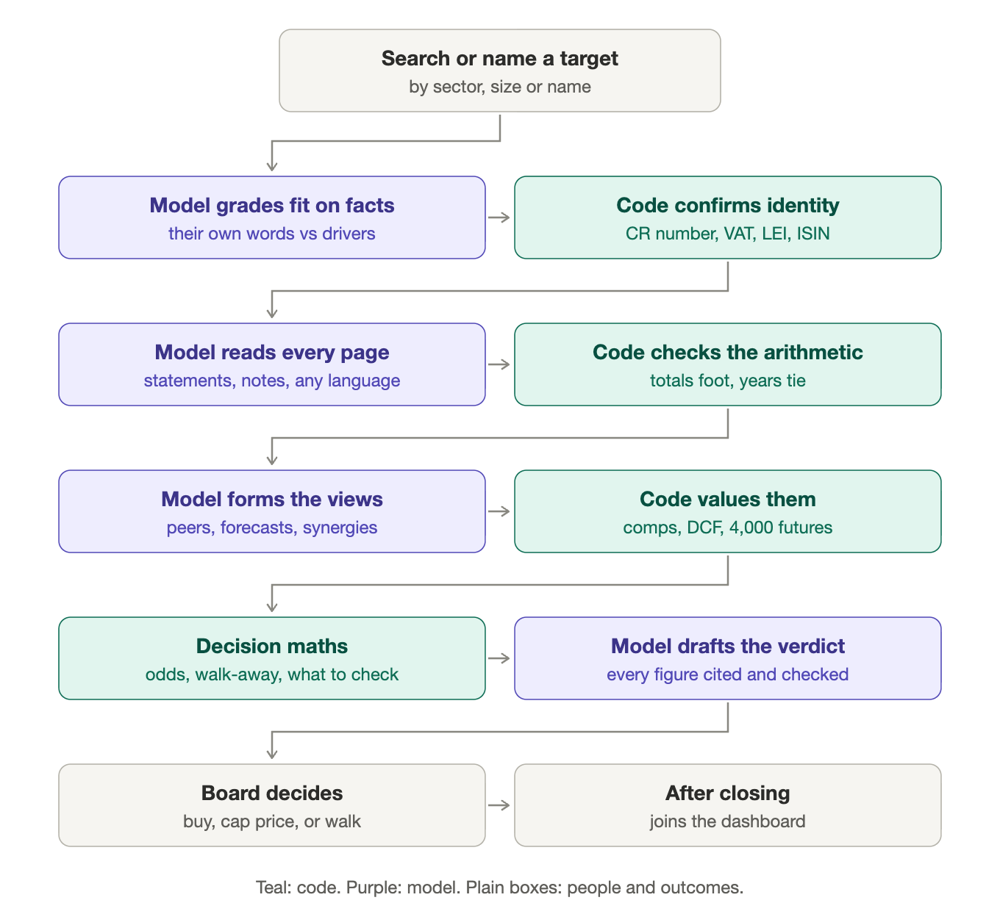

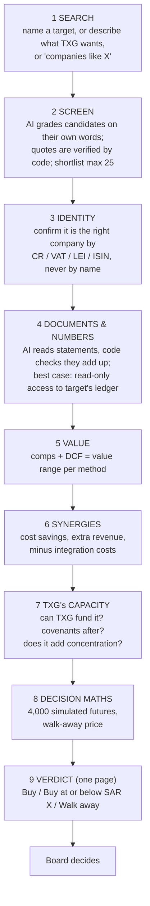

### Why not judge deals by EPS?

> Pay SAR 500m for a business earning SAR 50m after tax. Borrowing costs 5% after tax, i.e. SAR 25m interest. EPS goes **up** (50 - 25 = +25). But at an 11% cost of capital the business is worth only 50 / 0.11 = **SAR 455m**. You just **destroyed SAR 45m**.

So the tool uses: **Value created = standalone value + credible synergies - integration costs - price.**

### The key outputs

| Output | Meaning |
|---|---|
| **Football field** | Value range per method side by side |
| **Chance of creating value at price P** | Share of 4,000 simulated futures where the deal pays off |
| **Walk-away price** | Highest price where that chance is still at least, say, 70% |
| **Synergy gap** | Synergies needed to justify the asking price vs. what evidence supports |
| **Winner's curse shade** | In contested sales, the winner tends to have overestimated; this shades the bid down |
| **What to check next** | Ranked due-diligence list (value of information) |

If TXG gets **read-only access to the target's own books**, the whole finance engine runs on the target before signing: that is a **quality-of-earnings review** done by the same system.

---

## 9. Can we implement this properly? My assessment

> This section is **my own judgement** from reading the spec and the example folder. It is not in the spec. Use it to shape your reply to the client.

### 9.1 Short answer

**Yes for the proposal deliverables (made-up data, prototype, deck). Not yet provable for the real production product.** The spec itself says this: production is out of scope, and many Zoho and Saudi-source facts are marked **VERIFY** (unconfirmed).

### 9.2 Traffic-light summary

| Area | Verdict | Why |
|---|---|---|
| Example Holding data generator | 🟢 **Already well underway** | 10 of 25 companies generated, 20/20 checks passing on the sample (see Part 10) |
| KPI maths (40 KPIs, formulas) | 🟢 Feasible | Standard formulas; spec has hand-worked test examples |
| Statistics (normal ranges, false-alarm limit, simulations) | 🟢 Feasible | Well-known methods, libraries exist; effort, not risk |
| Trial-balance tie-out and holds | 🟢 Feasible | Deterministic code |
| Prototype web app (16 screens) | 🟡 Feasible but large | Lots of screens, drill-down on every number, live updates |
| AI account mapping, tagging, document reading | 🟡 Feasible; accuracy is the risk | Messy Arabic/English charts; "no approvals" means errors go live until reviewed |
| Real-time within seconds | 🟡 Easy on files, harder on real Zoho | Prototype replays a change feed (easy). Real Zoho has API rate limits and unverified webhooks |
| Sector modules (about 70 KPIs, 10 sectors) | 🟡 Large | Many need data Zoho does not hold (store areas, claims, fleet km) so they stay "needs data" without uploads |
| Valuation adapter (comps/DCF/deals) | 🟡 Depends on Sharpe code | Needs the desk code bundle handed over; precedent transactions never ran live |
| Real Zoho connector | 🔴 **Unproven** | Many endpoints/fields marked VERIFY; the spec says to test on a real organisation first |
| Saudi sources (Wathq, Qawaem, Saudi Exchange PDFs, Arabic PDFs) | 🔴 **Untested** | Spec itself says probe 3-5 companies before claiming anything |
| Production hosting/ops, Arabic UI | ⚪ Out of scope | Explicitly excluded |

### 9.3 Things I would raise with the client (honest concerns)

1. **Scope is very large for a proposal prototype.** Roughly: 25-company data generator, full engine, 40 + ~70 sector KPIs, 13 integrity tests, 16 screens, a generated deck, 23 fault tests and 14 "break" tests. The spec gives **no dates or estimates** ("the team estimates"). It needs an effort estimate and probably a cut line.
2. **"No approval steps" on financial data is a real design risk.** The dangerous error is a wrong mapping that keeps all totals correct but moves a line between KPIs (e.g. recurring revenue booked as "other income"). Two AI readings from the same model family may agree on the same mistake. The spec mitigates it (marker, review page, riyal-effect measurement), but a CFO may still expect a sign-off on mappings. Worth confirming TXG is comfortable.
3. **Real-time "within seconds" depends on Zoho.** Zoho limits: 100 calls/minute per organisation and a daily allowance by plan (about 1,000-10,000). Backfilling 3 years of invoices with line items can take **days** on lower plans (the spec's own example: 3 days on Premium, 14 on Standard). Webhook coverage per record type is unverified, though the safety-net poll covers gaps.
4. **Zoho facts are from web search, not tested.** The spec says Zoho's API pages were blocked when it tried to open them. Field names in the fake data are therefore guesses until checked on a real organisation. The spec already schedules that as the Appendix E checklist.
5. **Accuracy of valuation on Saudi companies is unproven.** The forecasting ranges were calibrated on about 1,800 US/Korean filers; untested on Saudi private companies. The deck is told to label this "to be proven".
6. **Cost of AI.** Heavy AI use at onboarding (map every account twice, read documents). The spec suggests a small cap (e.g. USD 5) for the prototype and recorded answers elsewhere. Production cost is not estimated.
7. **Some inputs will not exist.** Many sector KPIs need operating data (store areas, claims, fleet) that has to be uploaded. Expect many tiles to show "needs data" at first.
8. **Zakat/ROIC and cost-of-capital are approximations**, labelled as such. Peer data for Saudi sectors may be thin; the fallback is group peers or the company's own history.
9. **Open decisions still blocking polish:** product name, meeting date, deck format, model budget, test Zoho organisation, desk code handover (spec section 20.1).

### 9.4 Suggested reply to the client (draft)

> We have gone through the specification. **Yes, we can implement the proposal deliverables properly**: the example group, the engine, the working prototype and the deck, on made-up data. The data foundation is already generating and passing its checks.
>
> Three things we want to be upfront about: (1) the real Zoho connection and the Saudi data sources (Wathq, Qawaem, Arabic PDFs) are not yet verified against live systems; we would test them in a pilot with one to three TXG companies before committing; (2) the "no approval step" design relies on code checks and second AI readings, so we recommend TXG confirms it is comfortable with a review-later model for account mapping; (3) the scope is large, so we would like to agree an order of delivery and an effort estimate before dates are fixed.

---

## 10. What is already built (the example folder)

Folder: `temp/txg-example-holding-2026-11-20/`

| Item | Status |
|---|---|
| Generated books for **10 of the 25** companies (EH-01, 02, 03, 05, 06, 07, 08, 09, 14, 21) | ✅ Done ("step 2") |
| Books in Zoho's JSON format, 1 Jan 2023 to 19 Nov 2026 (October 2026 last closed month) | ✅ |
| Answer key (`data/answer-key/`): what the engine should find | ✅ |
| Validation report: every check passing | ✅ (e.g. EH-01: 20 of 20; EH-07: 18 of 18) |
| Planted stories S1, S2, S4, S5, S6, S7, S8, S9, S13 | ✅ present |
| Remaining ("step 3"): budgets (S11), facility letters/covenants, payroll, printed trial balances (S12), acquisition target (S10), healthcare claims (S3), change-feed replay | ⏳ Not yet |
| Remaining 15 companies, engine, API, prototype, deck | ⏳ Not started in this folder |

### Example of a "planted story" and what the engine must find

**S1 (Contracting A):** two government customers start paying 38 days later from January 2026.

| Measure | 2025 | 2026 | Reading |
|---|---|---|---|
| Days late (avg, 3-month basis) | 34.6 | 53.1 | Slipping badly |
| DSO (October) | 134.9 | 157.0 | Customers slower |
| Cash conversion (12 months) | 1.00 | **-0.29** | Profit no longer becomes cash |
| Net debt ÷ EBITDA | 1.41 | **3.06** | Now above a typical 3.0x loan limit |

This is exactly the "profitable but cash is tightening" story in Figure 4.

**S4 (Retail A):** March 2026 sales -10.9% vs March 2025, but after removing Ramadan, like-for-like is **+3.9%**. The engine must say "not alarmed" for the drop but flag that nine new stores earn poor returns (ROIC 13.0% to 5.4%).

**S6 (intercompany):** Building Materials A says it is owed SAR 4.27m by Contracting B; Contracting B only recorded SAR 3.17m. **SAR 1.10m mismatch** = one unbooked invoice.

**"Quiet" companies** must stay quiet. A system that flags everything has failed.

---

## 11. Mini glossary

| Term | Plain meaning |
|---|---|
| **Zoho Books** | Cloud accounting software each TXG company uses |
| **Ledger** | The book of all accounting entries |
| **Trial balance** | List of all account balances; debits must equal credits |
| **Chart of accounts** | The list of account names a company uses |
| **Standard ledger** | All companies' books translated into one common account list |
| **KPI** | Key performance indicator; a health number |
| **EBITDA** | Operating profit before depreciation (rough "cash profit") |
| **DSO** | Days sales outstanding; average days customers take to pay |
| **Days late** | How many days customers pay *after* the due date |
| **Covenant** | A condition in a loan, e.g. "debt must stay under 3x EBITDA" |
| **Headroom** | How far you are from breaching a covenant |
| **ROIC / WACC** | Return on invested capital / cost of capital; if ROIC > WACC the business creates value |
| **Economic profit** | (ROIC - WACC) x capital employed, in riyals |
| **Intercompany** | Sales between two companies in the same group; must be removed from group totals |
| **Synergy** | Extra value from owning two businesses together |
| **Walk-away price** | The most you should pay |
| **Snapshot** | An untouched, fingerprinted copy of source data |
| **Hold** | Automatic pause on one company-month whose data fails a check |
| **Second reading** | A second, blind AI opinion used instead of human approval |
| **Provisional** | A live number that may change when the month closes |
| **Heat-grid** | Companies x KPIs table coloured by health |
| **VERIFY** | In the spec: unconfirmed fact about an outside system, needs a real test |
| **Zakat / GOSI / ZATCA** | Saudi religious levy / social insurance / tax authority |
| **Wathq / Qawaem** | Saudi Ministry of Commerce company-register API / financial-statement filing platform |
