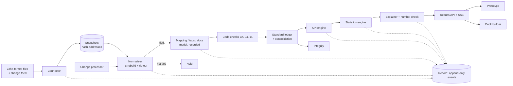
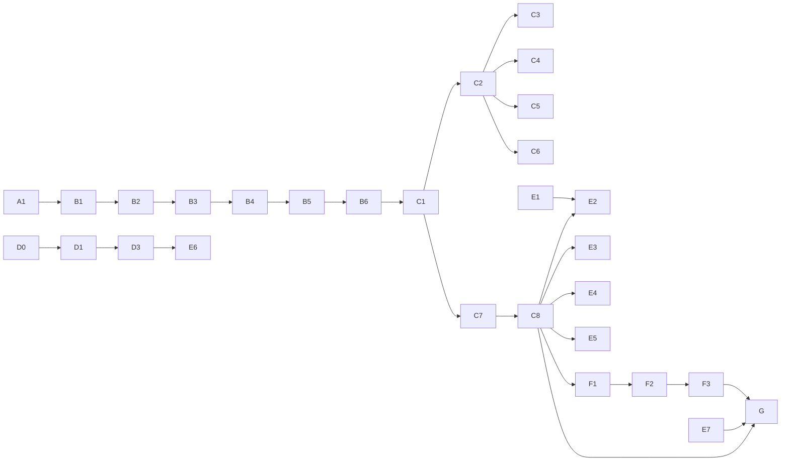

# TXG Group Finance Intelligence — Implementation Plan

> **For agentic workers:** REQUIRED SUB-SKILL: Use superpowers:subagent-driven-development (recommended) or superpowers:executing-plans to implement this plan task-by-task. Steps use checkbox (`- [ ]`) syntax for tracking.
> **Repo rule:** the user does all git. Every "Checkpoint" step means: stop, show the diff and test output, and let the user commit. Never `git add/commit/push`.
> **Cost rule:** never call a paid model in tests or verification. Model steps run on recorded or scripted answers (spec R14, §9.9). A live call needs the product lead's go-ahead under the cap (§20.1, e.g. USD 5).

> **STANDALONE OVERRIDE (user instruction, 2026-11-20 — binding over anything below):** this project lives at
> `livewiresDigitalSolutions/txg-finance-intelligence/`, fully separate from Sharpe AI. Nothing in `sharpe-ai-labs`
> is modified, imported, linked or copied as code. Consequences:
> - `txg-engine/` → `engine/`, `txg-prototype/` → `prototype/` inside this project.
> - No reuse of `py-build-server-main/src/docgen`, `sharpe-dashboard` components, `ts-agent-server-main` tools or its tracing. The deck uses python-pptx directly. The UI is scaffolded fresh (shadcn CLI). Model tracing is this project's own (optional LangSmith via its own env vars).
> - Client inputs (spec docx and Example Holding data and generator) are **copied** into `docs/spec/` and `data/`. They are client material, not Sharpe code.
> - Own `.venv`, own `.env`, own DuckDB files under `engine/runtime/`. No shared services or ports with Sharpe (API defaults to port 8710).

**Goal:** Build the four proposal deliverables in the client spec: Example Holding data, the engine, the working prototype and the generated deck. Reuse proven open-source libraries and in-repo code wherever they fit the spec exactly.

**Architecture:** This is a Python engine, a new `txg-engine/` package. It reads Example Holding's Zoho-format files through one connector interface and writes an append-only event record. It holds a DuckDB/Parquet store for the source ledger, standard ledger and results. A KPI registry holds one tested function per KPI, and a statistics engine runs on numpy/scipy/statsmodels/arch. A FastAPI results API serves a new Next.js prototype, `txg-prototype/`, and a deck builder that reuses `py-build-server-main/src/docgen`. Model steps (mapping, tagging, document reading, explanations) are typed JSON-schema calls, replayed from stored responses by default.

**Tech Stack:**
- Python 3.11+: pydantic v2, duckdb, polars, numpy, scipy, statsmodels, arch, PyPortfolioOpt (shrinkage only), hijridate, rapidfuzz, python-ulid, FastAPI, sse-starlette, openai SDK with structured outputs, langsmith tracing.
- Front end: Next.js 16, React 19, Tailwind 4, shadcn/Radix, ECharts (echarts-for-react), TanStack Table, Tremor copy-paste components (MIT).
- Deck: python-pptx via the existing `docgen` (if the §17.5 pilot picks option B).

**Spec:** `temp/TXG-Group-Finance-Intelligence-Build-Spec-v1.2.docx`. The plain-English explainer is `temp/TXG-Spec-Explained/TXG-Group-Finance-Intelligence-Explained.md`, and the sample data is `temp/txg-example-holding-2026-11-20/`. Section numbers such as §12.3 refer to the spec.

---

## Part 0 — Research findings

### 0.1 What the sample reference report got right and wrong

The reference report pasted with this request was checked against the repo and the web. Correct the record before planning on it.

| Claim in the reference | Verified finding | Consequence for the plan |
|---|---|---|
| "Over 60% of the hardest components are already built" | **Not true.** The repo has the *data generator* plus unrelated Sharpe products. It has no connector, ledger engine, KPI engine, statistics engine, results API or TXG UI. | Phases B, C and E are new code. |
| "`truth.py` has the 40 KPIs; port it into the engine" | `truth.py` (544 lines) computes **about 30 KPI columns** from the generator's *internal simulation*, not from the Zoho files. It is the **answer key**. | **Do not port it.** The engine must compute from the books. `kpis_monthly.csv` is the **test oracle** (Task C1). Copying it would make the tests circular. |
| "KSA calendar is 100% saved" | `calendar_ksa.py` hard-codes announced Ramadan/Eid dates for **2021–2026 only**. The spec needs 2023–2027 and announced dates stored on the record (§8.4). | Copy the table, add 2027, and store it as data. Use `hijridate` only as a cross-check. |
| "`hijri-converter`" | **Deprecated.** Its successor is **`hijridate`** (2.6.0, Jan 2026, Python ≥3.10). It is not for religious dates, because announced dates can differ by a day. | Use `hijridate` for cross-checks. Announced dates stay authoritative (spec §8.4). |
| "M&A valuation 90% saved — `ts-agent-server-main/skills/trading_comps`, `dcf`" | Those are prompt `SKILL.md` files (100 and 343 lines) plus `src/tools/comps_*.ts` and `dcf_*.ts`. All of them work on **uploaded Excel models (FMT)**. The spec's *peer tool `comps-peer-tool/1`*, *research desk with 4,000 futures*, *trade-buyer engine* and *decision sheet* are **not in this repo** (grep finds nothing). §14.11 says that desk code still has to be bundled for the team. | Phase D is **blocked** on the desk code handover (open decision in §20.1). Treat the existing comps/DCF tools as reference only. |
| "Deck builder 85% saved — docgen" | `docgen` is real python-pptx (compose, renderer, blocks, qa, verify). It is built for IM/teaser decks, not for a numbers-manifest audit. | Reuse the renderer and tokens. Add a fact-ID manifest and an audit script (Task F2). The format is still decided by the §17.5 pilot. |
| "DuckDB, zero ETL" | Correct, and the spec allows DuckDB in the prototype (§6.5). | Adopt it. |
| "beancount / medici for double entry" | `medici` is a Node/Mongo library. `beancount` brings its own ledger language. Neither fits Zoho registers. | Do not use. The balance checks are short SQL. |
| "benford_py" | `benford_py` 0.5.0 exists. It was not confirmed to implement first-two-digit MAD with Nigrini's cut-offs. `pybenford` claims the MAD classes. | Write the 15-line numpy version to the spec formula (§11.5 IT-01). Cross-check it once against `pybenford` in a test. |
| "STL / MAD bands for normal ranges" | **Contradicts the spec.** §12.2 fixes Shewhart XmR (X̄ ± 2.66·mR̄), and §12.1 fixes GLS with AR(1) holiday regressors. | Follow the spec: `statsmodels` `GLSAR` and our own XmR. No STL. |
| "Tremor for KPI cards" | Vercel acquired Tremor (Jan 2025). Tremor and its Blocks are now free under MIT, as copy-paste components. | Copy only the components needed. `sharpe-dashboard` has **no chart library** today. |
| "Fastembed pre-match to cut cost ~80%" | Plausible but not in the spec. A pre-match could bias the "independent second reading" (§9.10). | Optional. Use it only to build the *hint list* in the brief (allowed as a hint, R8), never as the reading. |

### 0.2 Reuse matrix: copy, use as a library, or write

**In this repo**

| Asset | Path | Use |
|---|---|---|
| Example Holding generator (10 companies) | `temp/txg-example-holding-2026-11-20/generator/` | Move it into the project as `txg-engine/generator/` unchanged. The client keeps producing step 3 and the other 15 companies (§19.1 Phase A). |
| Answer key | `data/answer-key/<code>/*.csv` | Test oracle for mapping (`chart_mapping.csv`), statements, KPIs, counterparties and payroll. |
| KSA holiday table | `generator/eh/calendar_ksa.py` | Copy the dates into `config/hijri_holidays.json`, and add 2027. |
| Standard chart (Appendix C) | spec | `config/standard_chart.json`, 73 accounts. |
| PPTX renderer, design tokens, QA | `py-build-server-main/src/docgen/{renderer,tokens,qa,preview}.py` | Import for deck option B. |
| Model tracing | `py-build-server-main` (langsmith); TS side `ts-agent-server-main/src/infra/tracing.ts` | Python model calls go through one traced client. Never import a model SDK untraced (past bug). |
| shadcn UI primitives, TanStack data grid | `sharpe-dashboard/components/ui`, `components/queries/data-grid.tsx` | Copy into `txg-prototype` as the starting kit. |
| Comps/DCF tools | `ts-agent-server-main/src/tools/comps_*.ts`, `dcf_*.ts` | Reference only, until the desk bundle arrives. |

**Open source**

| Spec need | Library | Licence / status | Decision |
|---|---|---|---|
| Ledger store, SQL over CSV/JSONL, snapshots → tables | **duckdb** | MIT | Use (§6.5 allows it in the prototype). |
| Data contracts (Appendix D) | **pydantic v2** | MIT | Use. Export JSON Schema for each contract. |
| Event IDs (ULID, §6.4) | **python-ulid** | MIT | Use. |
| GLS + AR(1) holiday model (§12.1) | **statsmodels** `GLSAR` | BSD | Use. |
| Benjamini–Hochberg (§12.3) | `statsmodels.stats.multitest.multipletests(method="fdr_bh")` | BSD | Use, plus our own q-value reporting. |
| Binomial tests (IT-02, TR-3) | `scipy.stats.binomtest` | BSD | Use. |
| Huber cost regression (§12.12) | `statsmodels.RLM(HuberT)`. Newey–West from `OLS(...).fit(cov_type="HAC")` | BSD | Use. Record that the HAC SE comes from OLS on the Huber-weighted data. |
| Block bootstrap (§12.6–12.8) | **arch** `CircularBlockBootstrap` (MBB under-samples edges per its docs) | NCSA | Use with a fixed seed. Block = 3. |
| Constant-correlation shrinkage (§12.18) | **PyPortfolioOpt** `CovarianceShrinkage(...).ledoit_wolf("constant_correlation")` (sklearn shrinks to the identity, which is wrong for the spec) | MIT | Use, or copy the about-40-line function to avoid the dependency. |
| Hijri cross-check | **hijridate** | MIT | Use in a test only. |
| Saudi public holidays | **holidays** (`SA`). Eids are estimates. Weekend Fri–Sat is not modelled. | MIT | Use for National and Founding Days. Eid comes from our announced table. The weekend is our own constant. |
| Fuzzy reference match (IT-08) | **rapidfuzz** (already a dependency) | MIT | Use. |
| Structured model output | openai SDK `responses.parse` / structured outputs with pydantic (the repo already uses openai). `instructor` is optional. | Apache/MIT | Use the SDK we already trace. Skip instructor unless a second provider is added. |
| KPI DAG / lineage | **Apache Hamilton** (function-level DAG, lineage as code) | Apache-2.0 | **Not adopted.** Our registry with `inputs` (§10.1) is enough and keeps the dependency count low. Revisit if incremental recompute grows complex. |
| Live push (§3.5: 10 s) | **sse-starlette** | BSD | Use. |
| Charts | **ECharts** (`echarts`, `echarts-for-react`), which matches §6.5 | Apache-2.0 | Use for the heat-grid, fan charts, Benford chart, football field and sparklines. |
| KPI cards, badges | **Tremor** copy-paste | MIT | Copy individual components and re-skin them with our tokens. |
| Tables | **@tanstack/react-table** (already present) | MIT | Use. |
| Zoho production sync | **Airbyte `source-zoho-books`** exists (invoices, bills, journals, contacts…) | ELv2 / MIT varies | **Not for the prototype**, which reads files (D-16). For production it is unverified for `registers`, `transactionlocks` and opening balances. Write our own read-only client behind the same interface after the Appendix E checklist. |
| Journal-entry testing | `je-tester`, ADS notebooks | small or unmaintained | Do not depend on them. The IT tests are short and spec-defined. |
| Benford | `benford_py` / `pybenford` | small | Reference only (see 0.1). |

**What is left to write (no library does these):**
- Trial-balance rebuild and tie-out.
- Mapping checks CK-04/05.
- Intercompany matching.
- Every KPI formula.
- XmR signals and impact ranking.
- 13-week cash simulator flows.
- Roll-rate Markov expected credit loss (ECL).
- Price/volume/mix bridge and Fisher index.
- Covenant headroom.
- Integrity tests.
- Explanation fact-checker.
- Results API.
- All screens.
- Deck manifest audit.

Each is short and pinned by spec formulas and hand-worked examples (§18.2).

### 0.3 Skills used to produce and execute this plan

| Skill | Where |
|---|---|
| `find-skills` | Searched; nothing in the skills ecosystem covers Zoho or holding-company finance. The local skills below are enough. |
| `superpowers:writing-plans` | This document. |
| `superpowers:subagent-driven-development` or `executing-plans` | Executing it. |
| `superpowers:test-driven-development` | Every task: oracle test first. |
| `superpowers:verification-before-completion` | Story-detection and replay gates. |
| `superpowers:systematic-debugging` | Any oracle mismatch. |
| `dataviz`, `frontend-design`, `shadcn` | Phase E. |
| `anthropic-skills:pptx` / `slideshow` | Deck pilot (§17.5). |
| Reviewers: `python-reviewer`, `typescript-reviewer`, `react-reviewer`, `security-reviewer`, `database-reviewer` | After each phase (CLAUDE.md rule). |

---

## Global Constraints

Values are copied from the spec. Every task implicitly includes these.

- Money in SAR. Display "SAR 23.4m" (one decimal, millions). Margins in % with one decimal. Days as whole numbers. Multiples with one decimal and "x" (§16.7).
- Trial-balance tolerance: **SAR 0.00 per account at two decimals** (§7.4). A mismatch **holds** that company-month automatically, and the hold lifts by itself (§9.10).
- Use `Decimal`, or integer halalas, for ledger sums. Never float for tie-outs.
- Reproducibility: the same inputs, configuration and seeds give **byte-identical** result files, checked by hash (§3.5, CK-16, CK-18). Seed = `hash(company, period, kpi, config_version)` (§12.6).
- Simulations: **10,000 paths** (§10.6). Acquisition futures: **4,000** (§14.8).
- False-alarm limit **q = 10%**. Materiality = **max(SAR 250k, 0.1% of annual revenue)** (§10.6).
- Normal-range window: **24 months before the latest 3, minimum 12**. XmR: **X̄ ± 2.66·mR̄**, σ̂ = mR̄/1.128. Rule B is **8** points on one side (§12.2).
- Peer bands: watch at **P25/P75**, act at **P10/P90**. Minimum peer set **5** (§10.6, CK-17).
- Cash weeks run **Sunday–Saturday**, 13 weeks. The weekend is **Friday–Saturday** (§3.2, §8.4).
- The model **never outputs a computed number**. Every explanation number is a fact reference `{f:…}` (R5, CK-14).
- **No approval steps** (R16). Second reading for material mappings, covenants, modules, material one-offs and material customer tags (§9.10).
- Identity **by identifiers only** (CR, VAT, LEI, ISIN, Zoho IDs), never by names (R9).
- No hard-coded lists of customers, accounts or industries in code (R8). The KPI list, modules, tolerances and periods are configuration (R10).
- Every page and slide is labelled **"Example Holding, made-up data"**. TXG's name appears only on the deck cover and the roll-out slide (§16.1, §17.4).
- Personal names (contacts, employees) are never sent to model providers (§6.6).
- Performance: pages ≤ **2 s**, source change on screen ≤ **10 s**, what-if ≤ **5 s** (§3.5).
- English only. Layouts must allow right-to-left later. WCAG AA. Colour always comes with an icon and a word. Every chart has a table view (§3.5, §16.7).

## Review Focus

These are the inputs most likely to bite that no spec test names directly. Each has a test in its owning task.

1. **Arabic and bilingual account names, with mixed scripts and RTL marks** (layouts B, C and E). Normalisation must not corrupt the name sent to the model or shown on screen. Test in **Task B2** (`test_normalise_keeps_arabic_names_byte_exact`).
2. **Non-December year end** (EH-13, 31 March). "Last 12 months", Zakat due dates and year-to-date budget must use the company's fiscal year. Test in **Task C1** (`test_ytd_uses_company_fiscal_year`).
3. **Partial (open) month mixed with closed months.** November 2026 is open, and month-end entries are missing. Live KPIs must use rolling windows and must never compare a partial month with a full one (§6.3). Test in **Task C2** (`test_open_month_kpi_marked_provisional_and_not_compared`).
4. **Division by zero or negative denominators.** EBITDA ≤ 0 shows "n.m.". No interest gives no interest cover. No inventory makes CS-3 "not applicable". Test in **Task C1** (`test_edge_case_states`).
5. **Foreign-currency bills (EUR, CNY) and pre-go-live open documents** (`cf_balance_at_go_live`). Ageing and DPO must use SAR at the document's `exchange_rate` and the go-live balance. Test in **Task B3** (`test_fx_and_go_live_balances_in_subledger`).

---

## Part 1 — Target layout

```
sharpe-ai-labs/
├── txg-engine/                      # NEW, Python 3.11, uv
│   ├── pyproject.toml
│   ├── config/
│   │   ├── standard_chart.json      # Appendix C
│   │   ├── kpi_registry.json        # §10.1 entries (40 common + sector modules)
│   │   ├── tolerances.json          # §10.6 defaults, versioned
│   │   ├── hijri_holidays.json      # announced dates 2021–2027
│   │   └── modules.json             # §11.3 module catalogue
│   ├── generator/                   # moved from temp/…/generator (client-owned)
│   ├── src/txg/
│   │   ├── record/                  # C18 event log, hashing, replay
│   │   ├── connector/               # C1 file source + change feed; production API stub
│   │   ├── snapshots/               # C4 content-addressed store
│   │   ├── normalise/               # C5 source tables, TB rebuild, tie-out
│   │   ├── modelsteps/              # C6–C8, C13: briefs, schemas, recorded client, checks
│   │   ├── ledger/                  # C9 standard ledger, consolidation, intercompany
│   │   ├── kpi/                     # C10 registry loader + one file per KPI family
│   │   ├── stats/                   # C11 adjustment, XmR, BH, ranking, sims, peers
│   │   ├── integrity/               # C12 IT-01…IT-13
│   │   ├── explain/                 # C13 fact store, number checker
│   │   ├── valuation/               # C14 adapter (blocked on desk bundle)
│   │   ├── changes/                 # C19 change processor, incremental recompute
│   │   ├── api/                     # C15 FastAPI + SSE
│   │   └── deck/                    # C17 manifest + audit, calls docgen
│   └── tests/
│       ├── unit/  oracle/  stories/  faults/  breaks/  replay/
│       └── fixtures/recorded_model/  # stored model responses (R14)
└── txg-prototype/                   # NEW, Next.js 16 + shadcn + ECharts
```

**Why a new package rather than inside `py-build-server-main`?** That server is a deployed product with its own dependencies and Render config. TXG is a separate proposal with a fixed spec. Keeping them apart avoids coupling and lets TXG move to in-Kingdom hosting later. *(Open decision O-1 below.)*



---

## Part 2 — Phases and tasks

The phases follow the spec's build order (§19.1). Each phase is reviewed by the product lead before the next one starts. **Phase B is written at execution granularity, because it is next.** Phases C–G list the tasks with their interfaces and oracle tests. Expand each one with `writing-plans` just before it starts, because their exact files depend on Phase B's code.

### Phase A — Data (client-owned; our tasks are intake only)

The client is producing the data alongside the spec (§19.1). The 10-company set is delivered. **Still missing** (README "Next"):
- budgets (S11);
- facility letters and compliance certificates;
- payroll/GOSI and headcount;
- sector uploads;
- printed trial balance per closed month (S12);
- the change feed with its replay script;
- the acquisition universe and target (S10);
- healthcare (S3);
- the remaining 15 companies.

#### Task A1: Intake and reproducibility gate

**Files:**
- Create: `txg-engine/generator/` (copied verbatim)
- Create: `txg-engine/tests/replay/test_generator_reproducible.py`

- [ ] **Step 1: Write the failing test** `test_generator_output_matches_hashes`. It runs `python3 generator/generate.py --out <tmp>` and asserts that every file hash equals `hashes.json`.
- [ ] **Step 2: Run it.** `uv run pytest tests/replay/test_generator_reproducible.py -v`. Expected: FAIL until the generator is copied in.
- [ ] **Step 3: Copy the generator.** Add a `make data` target that writes to `txg-engine/data/`, which is git-ignored.
- [ ] **Step 4: Run it again.** Expected: PASS, about one minute.
- [ ] **Step 5: Checkpoint** (user commits).

---

### Phase B — Engine core (execution detail)

#### Task B1: Project skeleton, record and snapshots (C4, C18)

**Files:**
- Create: `txg-engine/pyproject.toml`
- Create: `src/txg/record/events.py`, `src/txg/record/store.py`
- Create: `src/txg/snapshots/store.py`
- Test: `tests/unit/test_record.py`, `tests/unit/test_snapshots.py`

**Interfaces (produces):**
```python
class Actor(BaseModel): kind: Literal["code","model","person"]; id: str; version: str
class Event(BaseModel):            # §6.4, frozen
    event_id: str                  # ULID, set by store
    type: str                      # e.g. "snapshot.stored", "tb.tied", "hold.started"
    at: datetime; actor: Actor
    scope: dict[str, str]          # company, period, run_id
    inputs: list[Ref]; outputs: list[Ref]   # Ref = {id: str, hash: str}
    params: dict[str, str]; model: ModelCall | None; parents: list[str]
class EventLog:
    def append(self, e: Event) -> str: ...            # returns event_id; never mutates
    def by_scope(self, **scope) -> list[Event]: ...
class SnapshotStore:
    def put(self, source: str, record_type: str, org: str, payload: bytes) -> Snapshot: ...  # sha256, idempotent
    def get(self, snapshot_id: str) -> bytes: ...
```
Storage is a DuckDB table `events`, append-only, enforced by a no-UPDATE/DELETE API. Snapshots are files at `snapshots/<sha256[:2]>/<sha256>`.

- [ ] **Step 1: Write the failing tests.**
  - `test_append_assigns_sortable_ulid`: two appends give ids with `id1 < id2`.
  - `test_events_are_immutable`: there is no update method, and the model has `frozen=True`.
  - `test_snapshot_put_is_idempotent`: putting the same bytes twice gives the same id and one file.
  - `test_snapshot_hash_is_sha256_of_bytes`.
- [ ] **Step 2: Run them.** `uv run pytest tests/unit/test_record.py tests/unit/test_snapshots.py -v`. Expected: FAIL (import error).
- [ ] **Step 3: Implement** the signatures above.
- [ ] **Step 4: Run them again.** Expected: PASS.
- [ ] **Step 5: Checkpoint.**

#### Task B2: File connector and change feed (C1, part of C19)

**Files:**
- Create: `src/txg/connector/base.py`, `src/txg/connector/files.py`, `src/txg/connector/changefeed.py`
- Test: `tests/unit/test_connector_files.py`

**Interfaces:**
- Consumes: `SnapshotStore.put`, `EventLog.append` (B1).
- Produces:
```python
class Connector(Protocol):          # identical for files and the future Zoho API (R14, D-16)
    def organisations(self) -> list[OrgRef]: ...
    def iter_records(self, org: str, record_type: RecordType) -> Iterator[RawRecord]: ...
    def fetch(self, org: str, record_type: RecordType, zoho_id: str) -> RawRecord: ...
class FileConnector(Connector): def __init__(self, root: Path): ...
class ChangeFeed:  def events(self) -> Iterator[ChangeEvent]: ...   # time-ordered; full new record
RecordType = Literal["organization","chartofaccounts","contacts","items","invoices","creditnotes",
  "customerpayments","salesreceipts","bills","vendorpayments","expenses","journals","bankaccounts",
  "banktransactions","purchaseorders","salesorders","projects","locations","inventoryadjustments",
  "openingbalances","transactionlocks","users","taxes","currencies"]
```
The file format is JSON Lines with the envelope `{"code":0,"message":"success","<type>":[...]}`, as in the README. There is no write path anywhere.

- [ ] **Step 1: Write the failing tests.**
  - `test_iter_records_counts_match_manifest`: for each record type, the count equals `manifest.json`.
  - `test_records_deduplicated_by_zoho_id` (F-03): inject a duplicate line and expect it yielded once.
  - `test_connector_has_no_write_methods`.
  - `test_normalise_keeps_arabic_names_byte_exact` (Review Focus 1): the EH-01 chart of accounts name `البنك - الحساب الجاري` round-trips exactly.
- [ ] **Step 2: Run them.** Expected: FAIL.
- [ ] **Step 3: Implement.** Use DuckDB `read_json_auto` only for bulk loads. `iter_records` parses with the stdlib `json` module so bytes are preserved.
- [ ] **Step 4: Run them again.** Expected: PASS.
- [ ] **Step 5: Checkpoint.**

#### Task B3: Normaliser, trial-balance rebuild and the hold gate (C5; CK-01, 02, 03, 07, 08)

**Files:**
- Create: `src/txg/normalise/tables.py`, `src/txg/normalise/trial_balance.py`, `src/txg/normalise/holds.py`
- Test: `tests/oracle/test_trial_balance.py`, `tests/faults/test_holds.py`

**Interfaces:**
- Consumes: B1, B2.
- Produces:
```python
def load_source_ledger(conn: Connector, org: str, db: DuckDB) -> SourceLedgerRef   # tables: source_accounts, ledger_lines, documents, document_lines, contacts
def rebuild_trial_balance(db, company: str, month: str) -> TrialBalance          # Decimal per account
def tie_out(tb: TrialBalance, printed: TrialBalance | None) -> TieResult          # tolerance Decimal("0.00")
def evaluate_period(db, company: str, month: str) -> PeriodStatus                 # open|closed|tied|held|published; emits tb.tied / tb.mismatch / hold.started / hold.released
def subledger_vs_control(db, company, month) -> list[Finding]                     # CK-07
```

- [ ] **Step 1: Write the failing tests.**
  - `test_tb_balances_every_month_all_companies` (CK-02): Σdebit = Σcredit for each of the 10 companies and every month from 2023-01 to 2026-10.
  - `test_tb_matches_answer_key_statements`: account closing balances aggregated by `chart_mapping.standard_code` equal `monthly_statements.csv` to SAR 0.00.
  - `test_tie_mismatch_holds_month` (F-06): the printed trial balance is off by SAR 1 on one account, so the status is `held`, the events include `hold.started`, and the previous month stays `published`.
  - `test_hold_releases_when_corrected` (F-06): re-run with a corrected file, so `hold.released` is emitted with no person actor.
  - `test_missing_month_pauses_trends` (CK-08, F-05).
  - `test_fx_and_go_live_balances_in_subledger` (Review Focus 5): open receivables include `cf_balance_at_go_live`, and EUR bills convert at `exchange_rate`. CK-07 passes for EH-08.
- [ ] **Step 2: Run them.** Expected: FAIL.
- [ ] **Step 3: Implement.** The trial balance is rebuilt as opening balance plus monthly debits and credits from `account_transactions.csv`. The printed trial balance arrives in step 3 data. Until then, the tests build it from the answer key, labelled as a fixture.
- [ ] **Step 4: Run them again.** Expected: PASS for all 10 companies.
- [ ] **Step 5: Checkpoint.**

#### Task B4: Model-step framework (contract, recorded client, checks, second reading)

**Files:**
- Create: `src/txg/modelsteps/contract.py`, `client.py`, `second_reading.py`
- Test: `tests/unit/test_modelsteps.py`

**Interfaces:**
```python
class ModelStep(Generic[Brief, Out]):            # §9.2
    name: str; schema: type[Out]; model: str; prompt_version: str
    def run(self, brief: Brief) -> StepResult[Out]: ...        # validates schema; records prompt/response hash, tokens, cost
class RecordedClient:  # default in tests and prototype; keyed by (step, prompt_hash)
    def complete(self, step: str, prompt: str, schema: type) -> str: ...  # raises MissingRecording, never calls a network
class LiveClient:      # openai structured outputs + langsmith trace; enforces run budget cap; resume from record (F-20)
def reconcile(first: StepResult, second: StepResult, effect_sar: Callable[[Out], Decimal],
              materiality: Decimal) -> Decision      # §9.10: agree→apply; disagree→higher confidence (first on tie); unreviewed if effect ≥ materiality
```

- [ ] **Step 1: Write the failing tests.**
  - `test_invalid_json_rejected_and_finding_sent_once` (F-09).
  - `test_recorded_client_never_hits_network` (patch the socket and expect no call).
  - `test_budget_cap_stops_and_resumes_without_repeat` (F-20).
  - `test_reconcile_disagreement_above_materiality_marks_unreviewed` (F-21).
  - `test_second_reading_never_sees_first` (the second brief has no first-reading field).
- [ ] **Step 2: Run them.** Expected: FAIL.
- [ ] **Step 3: Implement.** `LiveClient` exists but is constructed only when `TXG_LIVE_MODEL=1` and a cap is set.
- [ ] **Step 4: Run them again.** Expected: PASS.
- [ ] **Step 5: Checkpoint.**

#### Task B5: Account mapping, tags and checks (C6, C7; CK-04, 05, 06, 12)

**Files:**
- Create: `src/txg/modelsteps/mapping.py`, `tags.py`, `scripted.py`
- Create: `src/txg/normalise/mapping_checks.py`
- Test: `tests/oracle/test_mapping.py`, `tests/stories/test_s13_misc_income.py`

**Interfaces:**
```python
def mapping_brief(db, company: str, account_id: str) -> MappingBrief     # §9.3 fields; personal names stripped
class MappingProposal(BaseModel): account_id: str; std_code: str; confidence: Literal["high","medium","low"]; evidence: list[str]; alternatives: list[str]; note: str | None
def check_mapping(db, company: str, version: int) -> list[Finding]       # CK-04 coverage, CK-05 BS identity + RE roll-forward, sign plausibility, zoho_type vs class
def apply_mapping(db, company: str, proposals: list[Decision]) -> int     # returns new mapping version; recomputes history
```
`scripted.py` is the labelled stand-in (§9.9). It answers from the Zoho account type plus name keywords as *hints*. It is deliberately imperfect, so the checks and second reading get exercised. Recorded real responses replace it once the live go-ahead is given.

- [ ] **Step 1: Write the failing tests.**
  - `test_every_account_with_balance_mapped` (CK-04, F-07).
  - `test_mapped_bs_identity_holds_every_month` (CK-05).
  - `test_revenue_to_asset_mapping_fails_check_and_is_reproposed` (F-08).
  - `test_mapping_accuracy_report_vs_answer_key`: writes the share of balance mapped correctly per company against `chart_mapping.csv`. The acceptance threshold is open decision O-4.
  - `test_s13_disagreement_marks_hl1_hl3_unreviewed` (S13, F-21).
  - `test_override_creates_version_and_recomputes` (F-22).
- [ ] **Step 2: Run them.** Expected: FAIL.
- [ ] **Step 3: Implement.**
- [ ] **Step 4: Run them again.** Expected: PASS.
- [ ] **Step 5: Checkpoint**, then run the `python-reviewer` and `security-reviewer` agents on Phase B.

#### Task B6: Standard ledger, statements and consolidation (C9; CK-09, CK-19; §12.17)

**Files:**
- Create: `src/txg/ledger/standard.py`, `statements.py`, `intercompany.py`, `consolidate.py`
- Test: `tests/oracle/test_statements.py`, `tests/stories/test_s5_s6.py`

**Interfaces:**
```python
def standard_ledger(db, company: str, mapping_version: int) -> StdLedgerRef
def statements(db, company: str, month: str) -> Statements          # P&L, BS, indirect CF (CK-06 ties to cash)
def match_intercompany(db, month: str) -> list[ICMatch]             # by VAT/CR identifiers only (R9); reference_number ↔ bill_number
def consolidate(db, month: str, ownership: dict[str, Decimal]) -> Statements
def performance_mix_split(w0: list[Decimal], w1: list[Decimal], m0: list[Decimal], m1: list[Decimal]) -> tuple[Decimal, Decimal]
```

- [ ] **Step 1: Write the failing tests.**
  - `test_statements_match_answer_key` (per company and month).
  - `test_cf_change_in_cash_equals_cash_accounts` (CK-06).
  - `test_s6_mismatch_is_1_10m` (EH-05 SAR 4.27m against EH-02 SAR 3.17m).
  - `test_intercompany_matched_by_identifiers_not_names` (break B-07).
  - `test_perf_mix_hand_example`: (+1.00 pt, −3.67 pt) from §18.2.
  - `test_s5_division_margin_falls_while_each_rises` (21.41% → 21.15%).
- [ ] **Step 2: Run them.** Expected: FAIL.
- [ ] **Step 3: Implement.**
- [ ] **Step 4: Run them again.** Expected: PASS.
- [ ] **Step 5: Checkpoint.** This is the **Phase B review gate**: tie-outs and mappings for all delivered companies (§19.1).

---

### Phase C — Engine analytics (expand before starting)

| Task | Builds | Key interfaces | Oracle / acceptance tests |
|---|---|---|---|
| **C1** KPI registry + common KPIs | `config/kpi_registry.json` (the §10.2 shape for all 40). `src/txg/kpi/{registry,performance,payables,pending,cash,receivables,drivers,fragility,trust}.py`, one decorated function per KPI. | `@kpi(id, inputs=[...])`, then `compute(company, period, run) -> list[KpiValue]` (Appendix D.1, with `lineage_id`). | **`tests/oracle/test_kpis_vs_answer_key.py`**: every column in `kpis_monthly.csv` matches to 1e-4 for each company and closed month. Any mismatch is a definition question for the client, never a fudge. Hand examples from §18.2 (DSO 60/30/30, CEI 50.0%, economic profit 4.2m, headroom 6.7m). Also `test_edge_case_states` and `test_ytd_uses_company_fiscal_year`. |
| **C2** Statistics core | `stats/{holiday,xmr,fdr,rank,yardstick}.py` | `holiday_adjust(series, cal) -> Adjusted` (GLSAR, 90% CI gate). `normal_range(series) -> NormalRange`. `signal_p(x, nr) -> float`. `bh_filter(tests, q) -> (kept, not_alarmed)`. `status(kpi, yardstick, tol) -> Status`. | §18.2 BH example (keeps 3 of 5). **S4**: EH-14 March −10.9% raw lands in "not alarmed" with reason "holiday", and the adjusted effect is about +3.9% (`holiday_index_true` in the answer key). `test_open_month_kpi_marked_provisional_and_not_compared`. Breaks B-02 and B-05. |
| **C3** Simulations | `stats/{bootstrap,budget_sim,cash13,covenant}.py` | `cash_13w(company, as_of, seed) -> CashForecast` (D.5). `p_hit_budget(...)`. `breach_chance(...)`. | Seed reproducibility (CK-16, B-10). The low point is the **median** (B-04). Exactly 13 Sunday-start weeks (B-03). **S1**: EH-01 HL-7 is act. What-if "government +30 days" returns in ≤ 5 s. |
| **C4** Receivables and concentration | `stats/{rollrate,ecl,concentration,pvm,fisher}.py` | `roll_rates(...)`, `ecl(...) -> Decimal` (absorbing Markov chain), `hhi(...)`, `pvm_bridge(...)`. | §18.2 PVM example sums to −80 exactly (CK-15, B-06). **S8**: effective customers 20.26 → 3.95 at EH-07. **S2**: EH-08 purchase-price index against selling-price index; HL-3 healthy but slipping. B-12. |
| **C5** Integrity tests | `integrity/it01_benford.py … it13_beneish.py`, `cases.py` | `run_tests(company, period) -> list[IntegrityHit]`, CFO scope only. | **S7** (EH-21): bunching 3.1 against 1.3 (IT-02), 40 late journals (IT-03), 25 Friday postings by one rare user (IT-06), Benford MAD > 0.0022 on bills (IT-01). F-19 / F-23 lock edits (IT-04). |
| **C6** Explanations | `explain/{facts,checker,writer}.py` | `facts_for(company, period) -> list[Fact]`, `check(text, facts) -> CheckResult` (CK-14). | F-10: a typed number is refused, retried once, then a numbers-only card. Integrity wording stays "worth a look". Break B-09. |
| **C7** Change processor and month close | `changes/processor.py` (C19) | `apply(change: ChangeEvent) -> RecomputeSet`, using the registry `inputs` to recompute only the affected KPIs. | Feed replay updates the affected KPIs within seconds (integration). F-23: an edit in a closed month gives IT-04 plus a re-tie. Idempotent re-apply. |
| **C8** Results API | `api/` FastAPI. Routes mirror §16.2. SSE `/stream/{company}`. Role auth: CFO-only integrity, reviewer-only overrides. | Pydantic models = Appendix D.1–D.7. JSON Schemas exported. | Contract tests against the schemas. `test_integrity_route_forbidden_for_non_cfo`. Held months are never published (B-14). |

**Phase C gate:** KPI tables, signals, attention lists and "not alarmed" logs (§19.1), plus the story matrix (Part 3) for the delivered companies.

### Phase D — Valuation (blocked)

| Task | Builds | Blocker |
|---|---|---|
| D0 | Receive the desk/peer-tool/deal-engine bundle (§14.11). Read its contracts (`comps-peer-tool/1`). | **Product lead hand-over (O-3).** |
| D1 | `valuation/adapter.py` (C14) behind typed contracts, starting from recorded outputs (§19.4). | D0 |
| D2 | Fake world: 8 made-up listed peers and the S10 target data room (client step 3). | Client data |
| D3 | Decision maths wiring: walk-away price at c = 0.70, chance of value at ask, synergy gap, value-of-information list (D.7). The verdict is computed, not fixed (S10). | D1, D2 |
| D4 | Peer bands for C2 from the peer engine. Fallback to group peers (≥ 5), then the company's own normal (CK-17, F-13, B-11). | D1 |

### Phase E — Prototype (can start in parallel with C against recorded API payloads, §19.3)

| Task | Screens | Notes |
|---|---|---|
| E1 | Scaffold `txg-prototype`. Copy shadcn primitives and the data grid from `sharpe-dashboard`. Add one design-token file and ECharts. Add a status component (colour + icon + word, §10.5). Use `/frontend-design` and `/dataviz`. | Tokens shared with the deck (§17.4). |
| E2 | S-02 company page (Figures 4/5), S-03 KPI drawer with drill-down to the document. | Everything renders from the API and the registry. A test asserts **no numeric literals** in screen code (FR-12). |
| E3 | S-01 group page: heat-grid (ECharts heatmap, table view), value map, cash map, obligations calendar. | The S9 red column across EH-01/02/03/21. |
| E4 | S-04 cash (fan chart, what-if), S-05 receivables, S-06 integrity (CFO only). | |
| E5 | S-07 review page with overrides, S-15 settings, S-16 Sunday brief. | An override recomputes the history (F-22). |
| E6 | S-08 to S-14 acquisition screens. | After Phase D. |
| E7 | Live updates over SSE (≤ 10 s, no reload), light and dark contrast, Playwright E2E per §16.8. | `react-reviewer` and `typescript-reviewer` gate. |

### Phase F — Deck

| Task | Builds |
|---|---|
| F1 | **Pilot** slides 1, 11 and 20 as option A (Slides artifact) and as option B (python-pptx via `docgen`). Open the .pptx in PowerPoint and log the decision (§17.5, D-14). |
| F2 | `deck/manifest.py`: every number is a fact ID. `deck/audit.py` recomputes each one from the results and **fails on any mismatch** (§17.3). |
| F3 | The 23 slides plus appendix A1–A5. Headless screenshots of the prototype. Render check. Labels "made-up". TXG's name only on the cover and slide 22 (§17.6). |

### Phase G — Quality

- G1: fault matrix F-01…F-23 as `tests/faults/`. The connector-only faults (F-01, F-02, F-04, F-17) wait for the production connector.
- G2: breaks B-01…B-14 as `tests/breaks/` (mutation patches). The suite must fail for each one.
- G3: a nightly replay-hash sample (CK-18).
- G4: final reviewers and the product-lead sign-off.

---

## Part 3 — Story acceptance matrix (definition of done for the engine)

| Story | Company | Must detect (spec §15.4) | Data available now? | Test |
|---|---|---|---|---|
| S1 | EH-01 | RC-1 act, HL-5 act, HL-7 act, HL-8 watch, top of the attention list | ✅ | `stories/test_s1.py` |
| S2 | EH-08 | HL-3 healthy+slipping, PF-1 watch, DR-3 = purchase prices, HL-2 act | ✅ (HL-2 needs budgets ⏳) | `test_s2.py` |
| S3 | EH-17 | HLT-2 act, HL-5 watch, RC-1 watch | ❌ step 3 | — |
| S4 | EH-14 | March drop "not alarmed"; RET-1 positive; HL-4 and RET-7 act | ✅ | `test_s4.py` |
| S5 | EH-05/06/07 | Division margin falls; performance-versus-mix split | ✅ | `test_s5_s6.py` |
| S6 | EH-05/02 | SAR 1.10m mismatch; CK-09, GP-10, IT-12 | ✅ | `test_s5_s6.py` |
| S7 | EH-21 | IT-01, IT-02, IT-03, IT-06 | ✅ | `test_s7.py` |
| S8 | EH-07 | RC-5 effective number about 4, slipping | ✅ | `test_s8.py` |
| S9 | EH-01/02/03/21 | Red days-late column; GP-8; GP-9 moves | ✅ (12 and 25 later) | `test_s9.py` |
| S10 | Target | Computed verdict | ❌ step 3 + Phase D | — |
| S11 | EH-08 | TR-3 act, p ≈ 0.035 | ❌ budgets | — |
| S12 | EH-22 | Automatic hold, TR-1 act, self-release | ❌ printed TB | fixture-only now (B3) |
| S13 | EH-09 | Readings disagree; HL-1/HL-3 unreviewed; top of the review page | ✅ | `test_s13_misc_income.py` |
| Quiet | 11 companies | No act flag without a cause; flags consistent with q = 10% | partial | `test_quiet_majority.py` |

---

## Part 4 — Open decisions and blockers

| # | Decision / blocker | Recommendation | Owner |
|---|---|---|---|
| O-1 | Where the code lives | New `txg-engine/` and `txg-prototype/` at the repo root | You |
| O-2 | Model calls during the build | Scripted stand-ins now; recorded real responses for mapping and explanations under about USD 5 once approved (§20.1). Probe credits first. | Product lead |
| O-3 | Desk / peer-tool / deal-engine code | Needed before Phase D. Not in this repo. | Product lead |
| O-4 | Mapping accuracy threshold | The spec sets none. Propose ≥ 98% of material balance correct on the answer key; below that, improve prompts before the demo. | Product lead |
| O-5 | Step 3 data and 15 more companies | Client delivery; Phases C and E proceed on 10 companies | Client |
| O-6 | Deck format | Pilot F1 | Product lead |
| O-7 | Test Zoho organisation for Appendix E | Ask TXG or use a sandbox; production connector only | Product lead |
| O-8 | Python model client (this plan) vs TS agent server | Python, to keep the engine in one process. The TS server stays for Sharpe. | Tech lead |

## Part 5 — Order of work



The spec's own critical path is A → B → C → E/F. D runs in parallel once O-3 is resolved.

## Sources

- [hijridate on PyPI](https://pypi.org/project/hijridate/) · [hijri-converter deprecation](https://pypi.org/project/hijri-converter)
- [Airbyte Zoho Books source](https://docs.airbyte.com/integrations/sources/zoho-books)
- [benford_py](https://pypi.org/project/benford-py) · [pybenford](https://pypi.org/project/pybenford/) · [Severe testing of Benford's law (Nigrini thresholds)](https://arxiv.org/pdf/2202.05237)
- [Vercel acquires Tremor (MIT, free)](https://vercel.com/blog/vercel-acquires-tremor)
- [PyPortfolioOpt risk models — constant-correlation shrinkage](https://pyportfolioopt.readthedocs.io/en/stable/RiskModels.html)
- [arch time-series bootstraps](https://arch.readthedocs.io/en/latest/bootstrap/timeseries-bootstraps.html)
- [Apache Hamilton lineage](https://hamilton.apache.org/how-tos/use-hamilton-for-lineage)
- [python-holidays Saudi Arabia](https://python-holidays.readthedocs.io/en/latest/_autosummary/holidays.countries.saudi_arabia.html)
- [je-tester](https://github.com/tlex-web/je-tester)
